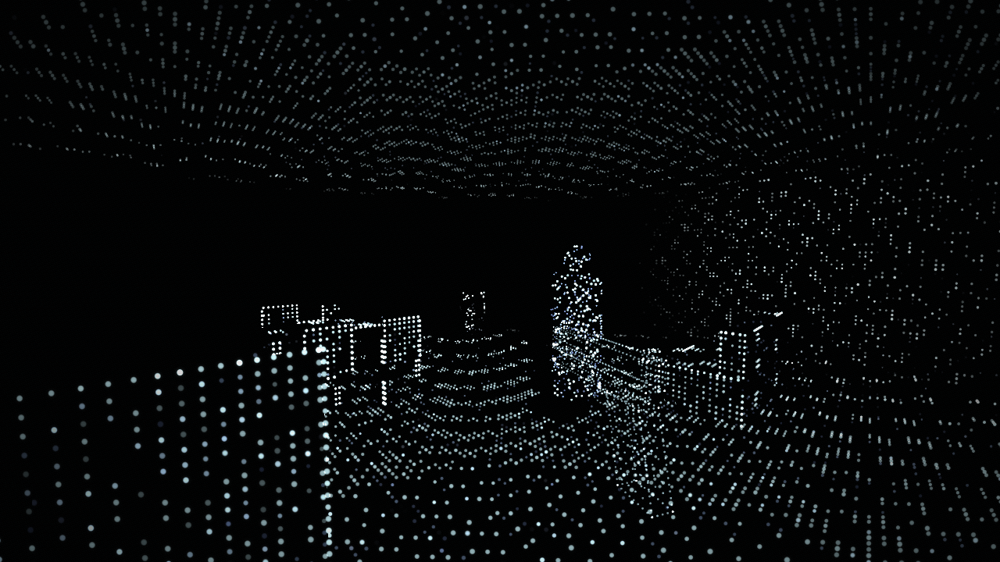
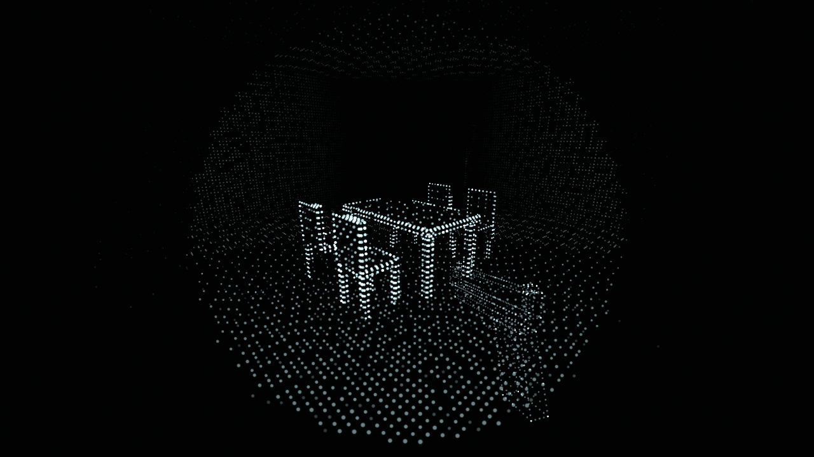

# REVERB

*Every sound is light.*

A first-person deathmatch in total darkness. Nothing is ever lit. Every sound (footsteps, tongue clicks, gunshots) casts rays that travel at a slowed speed of sound and leave glowing dot-matrix imprints where they hit walls, furniture, and bodies. The rays bounce, so a gunshot paints the room twice: first the direct wave, then a dimmer reverb. Dots that land on a player freeze where they hit, leaving a ghost image of where that body was. You hold the gun out in front of you, so every shot also paints your own hands and arms.

You vs 5 bots, free-for-all. The bots play by the same rules: they **hear** every sound, and they see only the echo dots that land on bodies in front of them, just like you. Every shot you fire lights up the room for you and also tells everyone where you are, and which way you're facing.

Sound bends round corners: a gunshot in the next room spills dimmer dots through the doorway, and you hear it coming from the doorway, not through the wall.

## Play
Open `index.html` in Chrome. No build step and no server: three.js is vendored in `vendor/`, so it runs offline straight from disk. Click to capture the mouse. **Headphones strongly recommended**: all audio is HRTF-spatialized with room-sized reverb.

| Key | Action |
|---|---|
| WASD | move |
| Shift | sprint (loud) |
| C / Ctrl | crouch (quiet) |
| E | tongue click: a forward echolocation cone |
| LMB | fire |
| RMB / Q | sonar dart: pings 3x where it lands |
| F | knife (backstabs kill) |
| R | reload |
| Tab | scoreboard |
| M | mute |
| ` | dev flags panel |

Floors matter: carpet muffles your steps, puddles and metal grates make them louder.

## Development
Version lives in `flags.js` (`R.VERSION`) and changes are logged in `CHANGELOG.md`.

Experimental features sit behind flags so old and new behaviour can be compared in the same build. Press ` in game to open the flags panel; changes save in the browser. To test a specific setup without touching saved settings, add it to the URL: `index.html?flags=stickyDots=0,bots=2,perf=1`. **Copy test URL** in the panel builds that link from your current changes.

To add a flag: add an entry to `DEFS` in `flags.js`, then read it with `R.flag('name')` where the behaviour branches. Flags that set a module constant get an `apply` function instead.

## How it's built
Plain browser JS, global `R` namespace, three.js r149 only for drawing the points.

| File | What |
|---|---|
| `flags.js` | version, feature flags, dev panel |
| `body.js` | humanoid bodies: capsule skeleton, walk cycle, pistol grip, ray tests |
| `core.js` | world (boxes, 3D raycasting, ~0.15 µs/ray), collision, nav grid, sound hearing by walking distance and round corners, input, loop |
| `echo.js` / `view.js` | ray-traced echo simulation (wavefront timing, bounces, lattice-snapped dots, ghost images on bodies) and the WebGL point renderer |
| `props.js` / `maps.js` | furniture built from thin boxes; Apartment, Office, Warehouse |
| `player.js` / `weapons.js` | FPS controller, footsteps, pistol, sonar darts, knife |
| `bots.js` | bots that hunt by sound and echo dots; each tick they score their possible actions and run the best |
| `audio.js` | procedural SFX, HRTF panning, occlusion, convolution reverb |
| `game.js` / `ui.js` | match flow, respawns, pickups, HUD with damage-direction arc |

`ROADMAP.md` has the plan (multiplayer next) and backlog. `tools/sim.js` runs a headless bot match for checking changes.

`SPEC.md` is the design document and the contract each module was written against.

Built with Claude Code: one Opus 5.5 orchestrator wrote the spec and core, and six Opus 5.5 agents built the modules in parallel.
